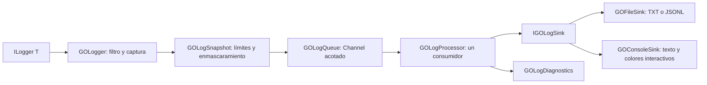

# Arquitectura

## Proyectos y dependencias

```text
All.sln
├─ src
│  ├─ mGO.Log.Abstractions   (Microsoft.Extensions.Logging.Abstractions)
│  ├─ mGO.Log               → Abstractions; Microsoft.Extensions.Logging
│  └─ mGO.Log.Extensions.Hosting → mGO.Log; Microsoft.Extensions.Hosting
├─ tests
│  ├─ mGO.Log.Tests         → mGO.Log; xUnit; Coverlet
│  ├─ mGO.Log.IntegrationTests → Extensions.Hosting; xUnit; Coverlet; ASP.NET Core
│  └─ mGO.Log.Benchmarks    → mGO.Log; BenchmarkDotNet
└─ samples
   ├─ mGO.Log.Console.Sample → Extensions.Hosting
   └─ mGO.Log.WebApi.Sample → Extensions.Hosting; ASP.NET Core
```

Abstractions contiene `IGOLogSink`, `IGOLogFormatter`, `GOLogEntry`, `GOLogEventKind` y los snapshots `GOLogExecutionContext`/`GOLogOperationContext`. Los modelos usan propiedades de solo lectura. El evento clona los `JsonElement` y usa diccionario/arreglo inmutables; no retiene objetos del consumidor ni la instancia de excepción.

## Flujo



El estado estructurado se reconoce como `IEnumerable<KeyValuePair<string, object?>>`. `{OriginalFormat}` se almacena como plantilla, no como propiedad común. Los scopes se capturan en orden externo a interno; se limita su cantidad. Los objetos se recorren por propiedades públicas legibles, diccionarios y enumerables; no se desestructuran campos. Los indexadores se excluyen. Un getter o formatter del consumidor que lance produce `CaptureFailures`; no se intenta registrar recursivamente ese error.

El formateador de mensaje proporcionado por .NET se ejecuta durante `Log`; los formateadores de salida y todo el I/O se ejecutan en el consumidor. Las opciones se validan y copian al crear el proveedor. No hay estado estático global mutable.

## Cola y barreras

El canal de eventos usa `BoundedChannelFullMode.Wait`, pero los productores usan exclusivamente `TryWrite` bajo un lock breve. La saturación se implementa explícitamente bajo el mismo lock: rechazar o leer el pendiente más antiguo y contar su descarte. El consumidor extrae lotes bajo ese lock y escribe fuera del lock. Así no se deducen pérdidas del valor devuelto por los modos Drop internos de Channel.

Un conjunto ordenado conserva las secuencias de los eventos aceptados aún pendientes, incluyendo el lote activo. Cada flush captura la secuencia aceptada actual. El consumidor puede completar su barrera cuando no queden secuencias anteriores o iguales, incluso si se descartaron por saturación. El conjunto ocupa espacio acotado por capacidad más lote; no acumula huecos de secuencias por descartes. Un segundo canal de capacidad uno agrupa las señales de trabajo.

`Processed` cuenta eventos escritos correctamente a todos los destinos; `Failed` cuenta una vez cada evento de un lote cuando falla al menos un destino. Se intenta cada sink aunque otro falle. Un sink que escriba parcialmente y lance deja todo su lote contabilizado como fallido; no se reintenta. `Dropped` cuenta rechazos, expulsiones y pendientes abandonados al cancelar el cierre. `SinkFailures` cuenta operaciones fallidas (incluyendo flush/dispose), y `CaptureFailures` captura errores antes de encolar. `LastError` guarda únicamente el tipo de excepción.

`FlushAsync` vacía buffers después de resolver la barrera; no garantiza fsync ni entrega de eventos fallidos/descartados. Una escritura fallida se informa por los contadores, mientras que un fallo al vaciar buffers se propaga al llamante del flush. El token cancela la espera del llamante, conservando la barrera interna para procesarla.

## Hosting y cierre

La extensión registra un solo `GOLoggerProvider` como singleton y un wrapper de `ILoggerProvider` deduplicable que reenvía scopes. Un `IHostedService` resuelve el mismo motor y lo detiene en el cierre. No se crea un motor adicional con llamadas repetidas a `AddGOLog`; sus delegados de configuración se acumulan en orden.

El procesador arranca en el constructor para aceptar también logs de inicio del host. La tarea se conserva y se observa en `StopAsync`/`DisposeAsync`. El cierre deshabilita captura, completa la cola y programa cancelación tras la gracia. Los sinks reciben ese token; se abandonan pendientes y se liberan destinos en `finally`. La cancelación de `StopAsync` por el host solo cancela la espera del host: la tarea del cierre sigue supervisada por el motor. Sinks que ignoren cancelación o se bloqueen en Dispose pueden prolongar el cierre.

## Persistencia y seguridad

`GOFileSink` recibe lotes en serie; no es seguro invocarlo concurrentemente fuera del motor. Rotación según el día UTC de procesamiento, no el timestamp de un evento atrasado. La cuenta de bytes se hace con UTF-8, incluyendo el salto LF. Se crea un archivo nuevo antes de escribir un evento que excedería el tamaño; un evento demasiado grande se mantiene completo en un archivo propio.

Los archivos nuevos se crean exclusivamente con `CreateNew`. `File.AppendOnStartup=false` mantiene un archivo nuevo por ejecución; con true, antes de crear uno se intenta continuar el último archivo compatible del día UTC actual, bajo el mismo lease. La continuación usa `FileMode.Open`, comprueba el tamaño y el último byte LF, y se posiciona al final sin truncar; si no cabe el siguiente evento o la línea quedó incompleta, crea otro archivo. La decisión de continuación solo se realiza al iniciar el sink; las rotaciones posteriores siempre abren un archivo nuevo.

El patrón se valida como un nombre, no como una ruta. Una expresión anclada limita los nombres administrados y extrae fecha/secuencia. El sidecar contiene el hash de identidad (aplicación/patrón) y el formato Json/Text; para retención se aceptan también los marcadores antiguos con solo el hash, pero no para continuación. La retención excluye enlaces simbólicos/reparse points y nunca borra el archivo activo. Las marcas huérfanas no se borran automáticamente. La retención se ejecuta al crear o reanudar el archivo activo.

El lease de archivo impide escritores simultáneos con la misma identidad. No es un protocolo de agregación multiproceso: configure rutas independientes y patrones que no se solapen. No hay protección contra cambios adversariales del sistema de archivos por un proceso con los mismos permisos.

El enmascaramiento se aplica por nombre exacto de clave (insensible a mayúsculas) antes de encolar y recorre valores estructurados/scopes. Las cadenas sensibles conocidas se sustituyen en el mensaje renderizado, plantilla y excepción capturados. No se garantiza eliminar secretos de texto libre ni representaciones personalizadas. Los límites acotan datos capturados, pero un getter o formatter del consumidor puede ser costoso o bloquear: el motor no puede aislarlo.

## Extensibilidad

Para usar otros destinos, implemente `IGOLogSink` y pase una colección explícita al constructor de `GOLoggerProvider`. La colección reemplaza los destinos de archivo y consola configurados; el motor se hace responsable de disponer los sinks. El sink de consola conserva la propiedad de sus TextWriter en el llamante. Mantenga las operaciones cancelables, evite logs recursivos y lance errores de I/O para que se contabilicen. Para registrar destinos propios con hosting, registre su singleton `GOLoggerProvider` antes de `AddGOLog`; `TryAddSingleton` respeta esa fábrica. Para otro formato de archivo, inyecte un `IGOLogFormatter` en `GOFileSink`.

`BeginGOLogOperation` crea un scope lógico de `ILogger` y registra estados estructurados de entrada/salida. El proveedor identifica el scope más interno y copia nombre, profundidad y tiempo monotónico al evento, incluso cuando no se materializan ScopeProperties. El contexto de proceso se consulta al crear el proveedor; el hilo se captura durante Log. No se inspecciona la pila ni se modifica un AsyncLocal estático propio. Véase [la adaptación de estilos](log-styles.md).

Los atributos `mGO.Log.Attributes.Trace.*` y `GOTraceAttribute` agregan instrumentación de métodos mediante una tarea MSBuild distribuida en buildTransitive. Roslyn realiza análisis semántico para distinguir los atributos propios y genera copias en obj, con un GOLogMethodTrace dispuesto por using/finally. Para métodos no async con Task/ValueTask, el runtime espera la tarea en un wrapper y separa el scope del llamante inmediatamente, conservando el contexto de la continuación. Los métodos async e iteradores usan el finally de la máquina de estados del compilador. Las herramientas Roslyn son privadas de compilación y no referencias de runtime del consumidor; se incluyen avisos de sus licencias en el paquete. [Detalle de instrumentación](method-decorators.md).
